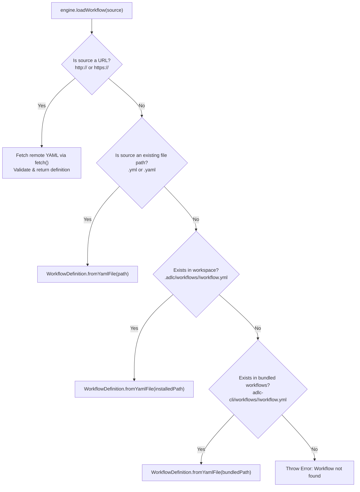

# Declarative Workflows & Catalog Architecture Design

**Status:** Proposed  
**Date:** 2026-11-02  
**Target:** `adlc-cli`  
**Related Specs:** `agentic-sdlc-spec-kit/workflows/ARCHITECTURE.md`, `ADR-391-amendment`, `ADR-395`, `ADR-469`

---

## 1. Intent and Context

`adlc-cli` currently embeds the `factory` outer-loop workflow inside JavaScript code (`src/workflow/builtins.mjs`) as an interpolated YAML template literal. This string embeds complex inline Node.js `child_process.spawnSync` wrappers that inspect the filesystem for bash helper scripts.

This hardcoded embedding caused severe drift:
- When `adlc-team-skills` merged `factory-product` and `factory-architect` into `factory-intent` (ADR-435), the CLI binary continued calling the deleted twins.
- When helper scripts were relocated from `factory-mission` to `factory-runbook` (#121), the CLI silently skipped steps, reporting false success on runs that pushed no branches and opened no MRs.
- Custom environments (like `adlc-argo-wf`) had to vendor full copies of `workflow.yml` into `.adlc/workflows/factory/workflow.yml` with a recurring "RE-SYNC OBLIGATION".

### Goals
1. **Manifested Declarative Workflows**: Replace embedded JS code in `builtins.mjs` with pure YAML workflow files located under `adlc-cli/workflows/<workflow-name>/workflow.yml`.
2. **Catalog Discovery & Packaging**: Ship `adlc-cli/workflows/catalog.json` defining bundled workflows with metadata (ID, version, description, entrypoint).
3. **Multi-Source Resolution**: Allow `adlc-cli workflow run <source>` to resolve from:
   - A direct HTTP/HTTPS URL (`https://.../workflow.yml`)
   - An installed workspace definition (`.adlc/workflows/<id>/workflow.yml`)
   - A bundled catalog asset (`adlc-cli/workflows/<id>/workflow.yml`)
   - A local filesystem path (`./path/to/workflow.yml`)
4. **Command Parity with Spec-Kit**: Port the catalog subsystem from `agentic-sdlc-spec-kit` to JavaScript (`src/workflow/catalog.mjs`), supporting `workflow search`, `workflow add`, `workflow list`.
5. **Zero Dependencies & Portability**: Pure Node.js (>= 18) stdlib, cross-platform (POSIX, Windows, macOS).

### Non-Goals
- Replacing the step execution engine (`src/workflow/engine.mjs` and `src/workflow/steps/`).
- Removing workspace-level `.adlc/workflows/<id>/workflow.yml` overrides (they remain top priority in resolution).

---

## 2. Directory Layout in `adlc-cli`

```text
adlc-cli/
├── workflows/                          # Bundled declarative workflows & catalog
│   ├── catalog.json                    # Bundled catalog index
│   └── factory/
│       └── workflow.yml                # Pure declarative YAML for factory outer loop
├── src/
│   ├── workflow/
│   │   ├── catalog.mjs                 # Catalog loader, search, fetch, and registry manager
│   │   └── engine.mjs                  # Updated loadWorkflow() with URL + catalog fallback
│   └── commands/
│       └── workflow.mjs                # workflow add, search, list, run
```

### Workspace Layout (`.adlc/` in target projects)
```text
.adlc/
└── workflows/
    ├── workflow-registry.json          # Installed workflows metadata & source tracking
    ├── factory/
    │   └── workflow.yml                # Workspace-installed or customized workflow
    └── runs/
        └── <run_id>/
            ├── workflow.yml            # Verbatim frozen copy of the executed workflow
            ├── state.json
            └── inputs.json
```

---

## 3. Workflow Catalog Specification (`workflows/catalog.json`)

Follows the schema established in `agentic-sdlc-spec-kit/workflows/catalog.json`:

```json
{
  "schema_version": "1.0",
  "updated_at": "2026-11-02T00:00:00Z",
  "workflows": {
    "factory": {
      "id": "factory",
      "name": "Factory Outer Loop",
      "description": "Factory outer loop — intent (product + architecture) → execution → sweep, with stage gates",
      "version": "2.0.0",
      "path": "workflows/factory/workflow.yml",
      "tags": ["factory", "outer-loop", "adlc"]
    }
  }
}
```

---

## 4. Multi-Source Workflow Resolution (`engine.mjs`)

When `adlc-cli workflow run <source>` or `engine.loadWorkflow(source)` is invoked:



### URL Consumption
- Supports fetching from standard HTTP/HTTPS endpoints (e.g. GitHub raw, GitLab raw).
- Includes standard timeout (30s) and size limits (e.g. 5MB max).
- Validates the fetched content is valid YAML and conforms to workflow schema before execution.
- Frozen verbatim copy is saved into `.adlc/workflows/runs/<run_id>/workflow.yml` as normal.

---

## 5. Declarative `factory/workflow.yml`

The bundled `factory/workflow.yml` contains zero string-interpolated JavaScript. All shell helpers are invoked through clean, explicit commands with fail-closed semantics:

```yaml
schema_version: "1.0"
workflow:
  id: factory
  name: Factory Outer Loop
  version: "2.0.0"

inputs:
  verdict:
    type: string
    enum: ["", approve, reject]
  mr_url:
    type: string
    default: ""
  issue_ref:
    type: string
    default: ""
  dispatch:
    type: string
    default: ""

steps:
  - id: run-branch
    type: shell
    run: bash .agents/skills/factory-runbook/scripts/bash/run-branch.sh || bash .agents/skills/factory-mission/scripts/bash/run-branch.sh

  - id: intent
    type: command
    command: factory-intent

  - id: publish-intent
    type: shell
    run: |
      (bash .agents/skills/factory-runbook/scripts/bash/run-branch.sh || bash .agents/skills/factory-mission/scripts/bash/run-branch.sh) && \
      (bash .agents/skills/factory-runbook/scripts/bash/open-mr.sh || bash .agents/skills/factory-mission/scripts/bash/open-mr.sh)

  - id: gate-product
    type: gate
    message: "Approve PDRs before architecture?"
    context:
      records: [".adlc/drafts/pdr/*.md"]
      since: last_approved
      link: "{{ steps.publish-intent.output.mr_url }}"
    options: [approve, reject]
    on_reject: abort
    verdict_input: verdict

  - id: gate-architecture
    type: gate
    message: "Approve ADRs before execution?"
    context:
      records: [".adlc/drafts/adr/*.md"]
      since: run_start
      link: "{{ steps.publish-intent.output.mr_url }}"
    options: [approve, reject]
    on_reject: abort
    verdict_input: verdict

  - id: execute
    type: command
    command: factory-mission
    input:
      args: "--issue {{ inputs.issue_ref }}"

  - id: gate-completion
    type: gate
    message: "Mission complete. Ready to merge?"
    context:
      link: "{{ steps.publish-intent.output.mr_url }}"
    options: [approve, reject]
    on_reject: abort
    verdict_input: verdict

  - id: sweep
    type: command
    command: factory-clean
```

---

## 6. Catalog CLI Commands

Ported from Spec Kit to `adlc-cli workflow`:

1. `adlc-cli workflow search [query]`: Searches bundled and remote catalogs, displaying ID, name, version, and description.
2. `adlc-cli workflow add <id|url> [--as <name>]`: Downloads and installs the workflow into `.adlc/workflows/<id>/workflow.yml` and registers it in `.adlc/workflows/workflow-registry.json`.
3. `adlc-cli workflow list`: Lists both installed workspace workflows and bundled workflows.
4. `adlc-cli workflow run <id|path|url>`: Direct execution with full resolution stack.

---

## 7. Migration & Clean Cut (No Shims)

1. **Delete `builtins.mjs` entirely**:
   - `src/workflow/builtins.mjs` is an internal implementation detail of `adlc-cli`, not an exported public API.
   - External consumers (`adlc-argo-wf`, `agentic-container`) only invoke `adlc-cli workflow run factory` via the CLI command line, never via JS `import`.
   - The 3 test files that import `builtins.mjs` will be updated to load from the catalog asset (`workflows/factory/workflow.yml`) or via `catalog.mjs`.
   - Zero shim code: no adapter, no deprecated wrapper.
2. **Existing runs**:
   - Resuming in-flight or parked runs continues to work seamlessly because runs reload their frozen copy directly from `.adlc/workflows/runs/<run_id>/workflow.yml`.
3. **Workspace overrides**:
   - Workspaces with `.adlc/workflows/factory/workflow.yml` continue to take precedence over bundled assets.
